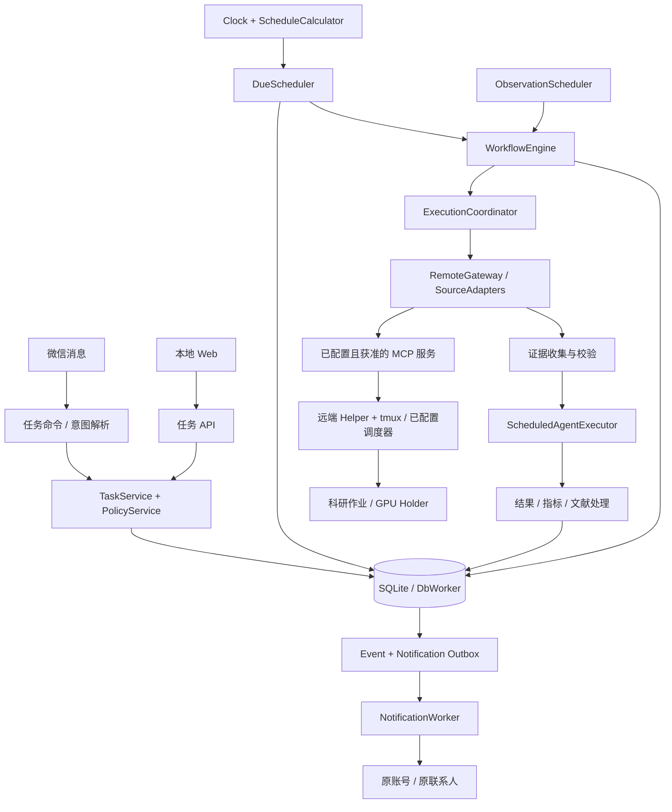
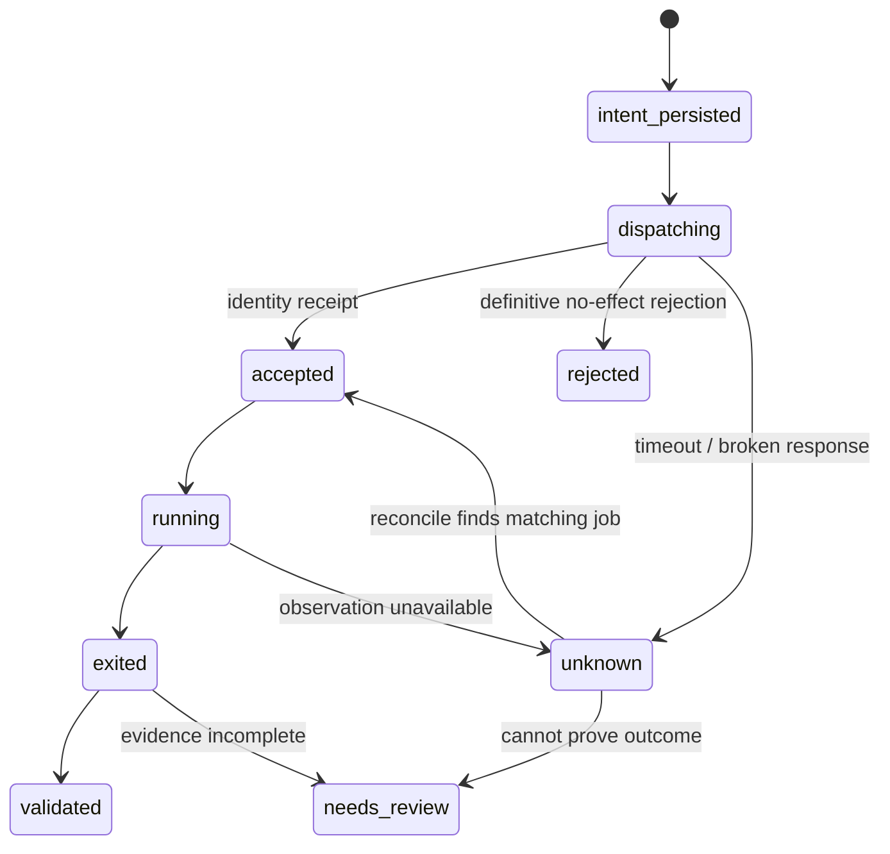
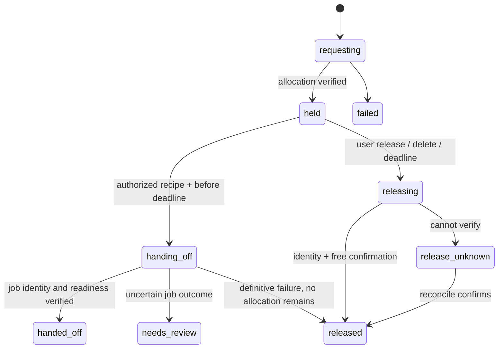

# 定时任务与科研自动化：System Design

项目：codex-weixin-Research  
编号：SD-SCHED-001  
版本：0.1，设计评审稿  
日期：2026-11-02，Asia/Shanghai  
需求基线：[SRS-SCHED-001 v0.2](../requirements/scheduled-tasks.md)，用户已认可。

本文定义拟实现架构、数据一致性、执行协议、故障恢复、接口边界和交付步骤。文中新增类、表、API、远端 helper 均为设计，不代表当前源码已具备。本文没有启动定时任务、连接服务器或占用 GPU。

2026-11-04 实现补充：原设计稿保留如下；当前实现状态以 [交付记录](../plans/full-feature-completion.md) 为准。模型适配器使用独立原生 app-server + 文本推理防火墙：验证只读/禁止审批、关闭继承工具，HTTP 请求层移除全部工具并在整个返回流校验后才交回执行器。另一种显式配置的 Responses API 端口同样没有工具执行器，不自动回退。远端 `research_helper.py` 是 SHA256 固定的显式安装组件，状态/锁位于远端本地盘，项目资料可在 NAS；物理保留用 CUDA driver，无 PyTorch 依赖。schema v4、不可变证据、外部操作意图和工作流分别持久化，科研列表沿用所有者绑定的分页协议。

## 1. 设计结论与约束

采用**模块化单体 + 本地 SQLite + 持久化状态机 + 远端受控执行 helper**：

1. 沿用现有 Node.js 本地桥接、微信账号管理与 Web，不引入独立云服务、Redis 或消息队列。
2. 服务持有调度和科研事实；模型负责解析与分析，不拥有时钟、重试、资源分配和实验生命周期。
3. 分开管理 Task、Occurrence、ControlRun、Workflow、ResearchJob、GpuLease 和 Notification。
4. 控制回合可以结束，远端实验继续；应用重启后根据身份核对，不重新推理一遍就再提交。
5. 关键状态、操作意图、事件与通知 outbox 使用同一个数据库事务；远程副作用通过操作身份和核对协议衔接。
6. GPU 两种模式均交付：满足条件直接启动；限时保留后交接。显存占用不等于获得整卡排他权。
7. 重用连接、账号、格式化与记忆入口；不直接复用现有 runner 的自动回退重跑及无条件记忆写入行为。

首版基线：实例 agent 定时并发 1、控制回合 15 分钟、普通启动宽限 5 分钟、GPU 采样默认 15 秒且最小 5 秒、训练观察默认 15 分钟、GPU 保留默认 30 分钟、完整实验自动重试默认 0。资源等待必须有用户/项目指定的截止时间。

## 2. 当前代码与新增职责

### 2.1 现有实现的接入点

| 现有文件 | 已观察到的行为 | 本设计如何接入 |
| --- | --- | --- |
| src/server/index.ts | 进程锁、HTTP、AccountManager、启停/升级 | 在 composition root 创建 AutomationRuntime 并纳入生命周期 |
| src/server/account-manager.ts | 账号隔离、MCP 之外的 Codex 会话执行、共享 runner | 提供账号/联系人目录、发送端口、前台执行协调钩子 |
| src/bridge/service.ts | 微信命令、普通消息与 context token | 增加任务命令和解析入口，收到有效入站消息时唤醒待发通知 |
| src/codex/runner.ts | withMemory、applyMemoryUpdates、auto backend 回退 | 抽出可选的底层能力；调度使用新的受限适配器 |
| src/codex/exec-runner.ts | 子进程运行、超时和停止 | 现有 stop 不足以证明整个进程树结束，新适配器使用 runId 级句柄 |
| src/bridge/memory.ts | 全局入口、项目导航、按需项目记忆 | 构建显式 projectId 上下文，保留原有按需读取原则 |
| src/state/json-store.ts | 单 JSON 临时文件替换 | 保持配置/聊天状态兼容；不用于多实体科研事务 |
| src/server/http-server.ts | Host、可选登录、Origin、请求 token | 所有新增 API 经过同一入口和鉴权链 |
| src/server/process-lock.ts | stateRoot 级服务单实例 | 继续使用；数据库约束与远端身份作为额外一致性保护 |

目前没有调度器、可查询科研作业账本或 GPU lease 协议。桌面会话能发现某个 MCP 工具，不等于后台 Node 服务已取得该工具连接与授权。

### 2.2 总体架构



图中边表示调用或数据流，不要求每个框部署成单独服务。只有数据库 worker 是本机新增工作线程；远端 helper 在获准服务器执行。Web 轮询和微信长轮询不是调度时钟。

## 3. 模块边界与调用约定

| 模块 | 持有职责 | 不承担的职责 |
| --- | --- | --- |
| AutomationRuntime | 启动、恢复、停止所有自动化组件 | 不替 AccountManager 接管普通聊天 |
| TaskService | CRUD、修订、请求幂等、状态与管理操作 | 不执行用户任意 shell 字符串 |
| PolicyService | 校验 actor、能力、recipe、目标、预算及当前授权 | 不从 memory 或模型文字推导授权 |
| ScheduleCalculator | 四类计划、时区、DST、下次时刻与漏跑区间 | 不启动进程 |
| DueScheduler | 到期登记、唯一 occurrence、排队与宽限 | 不负责模型总结 |
| WorkflowEngine | 有限阶段、关联作业、状态推进、终点和预算 | 不提供首版任意 DAG 或自主实验树 |
| ExecutionCoordinator | 槽位、项目冲突、GPU claim 与控制优先级 | 不把远程训练当一个长期模型 turn |
| ObservationScheduler | 共享 GPU 采样、作业观察、重试与陈旧度 | 不每次轮询调用模型 |
| RemoteGateway | 有授权的 MCP 调用、canonical alias、类型化命令 | 不使用 shell SSH 或直接读取凭据 helper |
| RemoteSupervisor / GpuHolder | 远端身份、进程、截止时间、输出与恢复证据 | 不替模型设计训练命令 |
| ScheduledAgentExecutor | 受限解析/分析、结构化输出、取消句柄 | 不直接提交实验、占卡、修改任务或自动写 memory |
| ResultService / LiteratureService | 验收、可比性、引用、去重、游标和报告 | 不把缺失证据补成成功 |
| EventProjector / NotificationWorker | 变化去重、持久 outbox、微信发送状态 | 不通过重跑实验修复通知失败 |
| AutomationStore | 事务、查询、约束、迁移和备份 | 不在事务中等待网络或模型 |

所有入口调用 application services；微信、Web、自然语言解析不得各自实现一套业务状态转换。模块通过端口注入，index.ts 负责组装，避免 TaskService 与 AccountManager 相互 import。

## 4. 持久化与部署

### 4.1 存储选择

科研场景需要同时提交 job、operation、workflow、预算消耗、事件及通知，采用单个 SQLite 数据库，避免多 JSON 文件之间出现部分成功。原 config.json 与聊天 state.json 保持原样。

建议使用 Node.js 24 的 node:sqlite，封装在专用 worker thread 中。官方文档将当前 Node 24 分支的该模块标为 release candidate，DatabaseSync 为同步 API，因此不放到 HTTP/微信事件循环中做查询和迁移。[Node 24 SQLite 文档](https://nodejs.org/download/release/latest-v24.x/docs/api/sqlite.html)

本机只读能力检查已确认 Node v24.22.2、SQLite 3.53.4 和 DatabaseSync 可用；这不是数据库故障恢复已验证的声明。自动化启用要求 Node >=24；原包 Node >=22 的兼容策略在实施时通过 feature capability gate 保留，不在本文手动改包版本。

数据库设置：foreign_keys=ON、journal_mode=WAL、synchronous=FULL、busy_timeout=5000ms。短事务使用 BEGIN IMMEDIATE；所有数据访问经单个 DbWorker 顺序执行，不在 SQL 事务中 await。UI 分页，避免一次读取完整历史。

数据库必须在本机可可靠锁定的磁盘上，不放在网络盘或正在同步的工作目录。WAL 不支持网络文件系统；因此本文默认 stateRoot 下本地目录，项目目录即便位于 OneDrive/NAS 也不承载活动数据库。[SQLite WAL](https://www.sqlite.org/wal.html) 不可靠路径检测命中则禁用自动化并给出迁移位置，不能静默切换空数据库。

### 4.2 目录

```text
<stateRoot>/
  config.json                    # 原配置，新增 automation 配置段
  runtime/<accountId>/state.json  # 原聊天会话/context token
  memory/                        # 原 memory 组织，不迁移
  automation/
    scheduler.sqlite             # 定义、状态、观察元数据、outbox
    artifacts/<runId>/           # 原始证据、JSON/CSV、报告、有限日志片段
    contexts/<runId>/            # 本轮模型的受控输入，非长期记忆
    backups/                    # 一致性备份与迁移前快照
    exports/                    # 人工导出包
```

默认 stateRoot 延续 ~/.codex-weixin-bridge，可由已有状态目录配置改变。所有相对引用由服务生成，下载根据 artifactId 查表；客户端不能给出任意磁盘路径。真实 automation 数据加入发布/版本控制排除规则，只提交 schema、模板、fixture 和文档。

### 4.3 文件与数据库的提交关系

产物先写同卷临时文件，刷新、重命名为不可变文件，再在数据库事务中登记摘要/hash/size，并提交结果和事件。崩溃遗留的未引用文件只能标为 orphan，不能据文件名推断成功；人工归档/清理前核对引用。已引用文件丢失时报告 artifact_missing，不重训练补文件。

启动只接受兼容 schema；迁移前做一致性备份，迁移本身事务化。不可将运行中的 .sqlite 文件单独复制当作 WAL 数据库备份；使用 SQLite 一致性备份/受控导出方式。损坏或未知新版本使自动化进入 degraded，普通管理页仍启动以显示问题，不重新创建空库。

## 5. 领域模型、身份和表约束

### 5.1 核心实体

所有私有实体含 owner_account_id 和 owner_sender_id；UUID 不能充当授权。所有时间字段为 UTC 毫秒或明确的 ISO UTC，计划另保存 IANA timezone。

| 表/实体 | 关键字段 |
| --- | --- |
| tasks | id、owner、kind、project_id/null、status、current_revision、created/updated_at |
| task_revisions | task_id、revision、完整定义 JSON、definition_hash、actor、received_at |
| schedules | task_id、revision、schedule_spec、timezone、next_due_at、cursor、exhausted_at |
| occurrences | id、task_id、revision、scheduled_at、source、status、start_deadline_at、workflow_id |
| control_runs | id、task/occurrence/workflow、stage、snapshot、agent_handle/thread_id、状态、实际模型/权限、起止时间 |
| workflows | id、occurrence_id、workflow_version、stage、status、next_check_at、waiting_deadline_at、budget_state |
| research_jobs | id、workflow_id、attempt_no、operation_id、recipe_snapshot、target_binding_hash、remote_identity、process_state、validation_state、log_cursor、manifest_ref |
| operations | id、effect_key、actor/scope、action、payload_hash、intent/result、state、error、reconcile_after |
| gpu_leases | id、workflow_id、operation_id、target、requested_bytes、remote_identity、deadline、state、handoff_job_id |
| resource_claims | id、target_key、gpu_uuid、holder_type/id、state、claim_epoch |
| observations | id、owner/subject、observed_at、validity、snapshot_hash、artifact_ref、previous_valid_id |
| results / artifacts | id、run/job、schema_version、指标/证据/局限、relative_path、checksum、size、media_type |
| events | id、subject、semantic_key、event_type、payload_ref、created_at |
| notifications / notification_parts | id、event_ids、owner、policy、state、content_ref、part 状态、恢复条件 |
| notification_attempts | id、notification/part、attempt_state、started/ended_at、response/error |
| literature_items / versions | 规范身份、版本、日期类型、来源、reading_level、证据 |
| literature_matches / source_cursors | task、item/version、筛选结果、provider/query/page/watermark、complete 状态 |
| idempotency_records | owner、request_key、request_hash、response_ref |
| audit_log / schema_migrations | 关键管理动作、状态变更与迁移记录 |

小型 JSON 保存版本化的配置/快照；查询、唯一性、状态和到期字段独立成列。表数不等于组件数，初始 migration 按上述职责实现，不使用全量 JSON 覆盖来代替事务。

### 5.2 身份生成和幂等边界

- request_key：微信 accountId + senderId + messageId + action index；Web 使用调用方生成的 Idempotency-Key。相同 key 不同 payload 返回 conflict。
- occurrence：计划修订 + scheduledUtc 唯一；manual occurrence 使用请求幂等键。普通扫描重试不生成新身份。
- workflow：每个明确 occurrence 对应一个执行流程。重复的每日实验可产生新 workflow，不被永久按 taskId 去重。
- job：一次明确实验尝试一个 jobId；允许的新重试使用 attemptNo + 新 operationId，并关联 parentJobId。
- effect_key：workflowId + stageId + attemptNo + action，唯一。事务提交后重复 worker 只能核对既有 operation，不能再产生新实验。
- lease：一次保留一个 leaseId；交接指向确定 jobId。GPU 按 server stable identity + GPU UUID 识别，索引只是当次显示信息。
- event semantic_key：subjectId + observed transition/version + eventType；重复观察同一终态只形成一项完成事件。

同一模板、命令或 taskId 不构成全局实验去重键。用户明确安排的新一次复现实验必须能运行。

### 5.3 必须在数据库/服务层维持的不变量

1. 唯一 occurrence、effect_key、request_key；新 intent 与预算扣减在同一事务。
2. 同任务最多一个 queued/running 控制回合；同 workflow stage 的外部操作最多一项未决 intent。
3. resource_claims 对同一服务器/GPU 的非终态 claim 使用唯一约束；unknown 仍占据本系统 claim，直到核查。
4. release 只针对 lease，stop 只针对明确 job；不能按 GPU 索引批量 kill。
5. schedule 耗尽不会删除 workflow 的观察与后续阶段；paused/deleted 的阻止范围显式保存。
6. 一次有效观察、语义事件、必要 outbox 项事务化。通知失败不回滚实验事实。
7. 文献已发现、已匹配、API 已接受通知分别保存；不能以游标前进代替通知成功。
8. actor 和 owner 从可信入口建立，所有访问/效果动作重新校验，不从模型输出或 URL owner 参数直接继承。

## 6. 定义契约与授权

下列为后续 TypeScript/Zod schema 的设计契约；实现需补齐所有约束，不能把示意类型当成已完成源码。

```ts
type ScheduleSpec =
  | { kind: 'once'; atUtc: string; timezone: string }
  | { kind: 'daily'; time: string; timezone: string }
  | { kind: 'weekly'; weekdays: number[]; time: string; timezone: string }
  | { kind: 'interval'; everySeconds: number; anchorUtc: string; timezone: string };

type TaskKind = 'reminder' | 'agent_report' | 'research_workflow'
  | 'job_monitor' | 'gpu_watch' | 'literature_watch';

type ResourcePolicy = {
  mode: 'observe' | 'launch_when_ready' | 'reserve_then_handoff';
  serverAliases: string[];
  candidateGpuUuids?: string[];
  gpuCount: number;
  minFreeBytesPerGpu: number;
  holderBytesPerGpu?: number;
  allowSharing: boolean;
  stableSamples: number;
  waitDeadlineUtc?: string;
  holdSeconds?: number;
};

type RecipeRef = { id: string; revision: number; digest: string };
type Capability = 'observe' | 'artifact_write' | 'job_submit'
  | 'gpu_reserve' | 'gpu_release' | 'job_stop' | 'project_memory_update';
```

任务定义还包括 owner、projectId、目标绑定、prompt、recipeRef、capabilities、模型/effort 选择、monitorPolicy、validationSpec、notificationPolicy、预算、工作流模板与修订。

Recipe 的 executable + argv 是结构化值；shell 脚本只能引用明确允许的路径/内容 digest。允许的变量是事先声明的 outputDir、GPU UUID、seed 等类型化参数，不执行模型临时生成的 shell 字符串。环境采用 envRef，秘密由现有凭据机制解析，不进入快照。代码版本策略明确为 pinned 或 latest_record；后者每次记录真实版本，不能把代码变更伪装为同一快照。

PolicyService 在保存、排队启动、每次外部副作用前校验：

```text
actor 仍有权访问 owner
AND task/revision/阶段仍允许此动作
AND 项目、服务器、路径、recipe digest 与目标绑定匹配
AND capability 已授予且宿主/MCP 当前也允许
AND 资源与重试预算尚有余额
AND 不存在未核实的相同 effect
```

授权是任务和范围的持续记录，不是每 15 秒向用户再问一次。默认只读；job_submit/gpu_reserve 必须来自明确任务意图或配置。旧任务因绑定路径、recipe 或权限实质变更失效时 blocked，不按全局新默认自动扩大范围。停止/释放可核对原快照执行 cleanup，不因普通 recipe 更新遗失清理能力。

## 7. 调度、并发和有限工作流

### 7.1 时间算法

ScheduleCalculator 是纯函数，注入 Clock；建议以 @js-temporal/polyfill 适配 Temporal，避免手写时区偏移规则。具体依赖锁定在实施时完成。Temporal 的 disambiguation 语义见 [TC39 文档](https://tc39.es/proposal-temporal/docs/zoneddatetime.html)，polyfill 来源见 [维护仓库](https://github.com/js-temporal/temporal-polyfill)。

- once 保存已校验 UTC；相对时间锚定原请求 receivedAt，不锚定模型解析完成时间。
- interval 用 anchor + n × interval，重启算出下一个 n，不依赖 setInterval 次数。
- daily/weekly 先枚举当地日期与时刻，再映射 UTC。不存在的当地时刻跳过，重复时刻选第一次；earlier/later 映射都要 round-trip 验证原墙上时刻，不能用 compatible 默认把春季空缺平移为另一个时刻。
- 唤醒使用短 timer，建议扫描上限 15 秒；即使 timer 漏唤醒，仍从持久 cursor 补核对。计划计算和 wall time 与控制超时使用的 monotonic clock 分开。
- 重复计划在一次事务中登记当前有效 occurrence/漏跑区间并前移 cursor；大量离线触发合并为 missed range，不逐条启动。
- 相对资源等待一旦在合法 occurrence 下建立 workflow，就按 waitingDeadline 续查，不套用普通 5 分钟启动宽限。

### 7.2 到期与排队

```text
tick(now)
  -> 事务扫描 next_due_at <= now 的 active schedule
  -> 校验修订/所有者，按唯一键登记 occurrence
  -> 超出普通 startDeadline：missed；否则创建 workflow/控制排队项
  -> 原子更新 schedule cursor/nextDueAt
  -> 调度器在事务外唤醒 dispatcher
```

dispatcher 在真正开始前再次核对修订、状态、deadline 和权限。排队等待超过普通启动宽限则 missed；进入资源等待后的检查不使用该宽限。暂停/编辑取消尚未开始的旧修订项；manual run 创建独立 occurrence，但不改变 nextDueAt。

### 7.3 槽位和冲突

- AgentSlot：实例默认 1；仅在模型工作期间占用，连接等待和远端训练不长期占位。
- TaskControlLock：同任务最多一轮控制回合。到期已运行则 skipped_overlap，不无限积压。
- ProjectEffectLock：保护同目标的提交/写入/交接。前台聊天开始前也经过协调钩子；管理命令不争抢此锁。
- RemoteIoSlot：每服务器默认一个短 MCP 操作，跨任务合并 GPU snapshot；控制/释放优先于新采样。长作业提交接口必须快速返回 receipt。
- GpuClaim：数据库约束 + 远端 per-UUID 锁；不把它当成阻止外部用户使用 GPU 的能力。

锁顺序固定：task/workflow → project → 按 server/UUID 排序的 GPU claims。数据库事务中不持有网络调用，失败释放规则由状态机决定；unknown 不直接释放资源所有权。新前台请求优先于尚未开始的定时模型回合，已经开始的工作不强制中断；同保护目标冲突时显示等待，并可单独停止自动化回合。

### 7.4 首版工作流模板

```text
report:     due -> collect -> analyze -> persist -> notify
experiment: due -> [wait_resources] -> submit -> observe -> validate
                 -> [evaluate / compare] -> report -> complete
reserve:    due -> wait_resources -> reserve -> [await_handoff]
                 -> handoff -> observe -> validate -> report
monitor:    attach_existing_job -> observe -> validate -> [report] -> complete
literature: due -> fetch_pages -> normalize/dedupe -> screen -> report
```

方括号表示保存定义时明确选择的阶段，不由模型临时扩展。占卡只有 lease、尚未选择交接方案时可等待用户，在 lease deadline 前不启动未知实验。达到终态后取消对应观察 timer；流程仍需要的其他 timer 不被一并删除。

scheduleStatus、workflowStatus、jobState、validationState、notificationState 独立显示。例：计划已耗尽、实验运行中、最近观察正常、微信 API 已接受，四个事实同时成立。

## 8. 远程执行协议与实验提交

### 8.1 MCP 适配边界

RemoteGateway 暴露以下应用接口；它们是本项目新增端口，不冒充 compute-server-management 已有同名工具：

```ts
interface RemoteGateway {
  capabilities(target: TargetRef): Promise<RemoteCapabilities>;
  snapshot(target: TargetRef, request: ObservationRequest): Promise<Snapshot>;
  dispatch(intent: AuthorizedOperation): Promise<OperationReceipt>;
  reconcile(target: TargetRef, operationId: string): Promise<ReconcileResult>;
}
```

PolyuMcpAdapter 刷新 servers_list，解析 canonical alias，校验用户、目标绑定与宿主调用权限，再通过获准的 ssh_exec 调用固定模板/helper。后台需配置长期可用的 MCP transport；标准 tools/list 和 tools/call 只是协议能力，并不自动获得宿主许可。[MCP Tools 规范](https://modelcontextprotocol.io/specification/2025-06-18/server/tools)

ConnectionProvider 只能解析现有获准 MCP 服务引用；它不读取 Windows 凭据文件、不改用 shell SSH。若当前工具只存在于桌面会话，必须先实现并验证同等授权的宿主桥接/后台 transport；在此之前相应目标标记 adapter_unavailable。宿主拒绝/never 策略返回 approval_denied，不通过新开客户端绕过。gateway 等用户未启用连接不自动纳入候选集。

### 8.2 Helper 部署与传输

远端新增版本化 Python helper，职责是执行已声明的机械操作。部署使用原 MCP 通道和明确允许的文件范围；不自动 pip/conda 安装训练环境。需要 GPU holder 的目标必须预检可用的 Python、CUDA/PyTorch 环境和监督/到期机制。

建议远端目录为配置的本机持久状态盘 remoteStateRoot，按 Unix UID 和 helper 版本隔离；不能默认把本地 Windows stateRoot 或 NAS 项目目录当作远端锁盘。上线预检要求该路径在目标服务器本地、可可靠创建锁并持久保存 manifest。具体物理目录由配置指定，不在文档编造用户路径。

```text
<remoteStateRoot>/<uid>/
  helper/<version>/             # 已校验 digest 的实现
  operations/<operationId>/      # intent、receipt、阶段与完成记录
  jobs/<jobId>/                  # manifest、exit.json、有限运行元数据
  leases/<leaseId>/              # deadline、holder、交接状态
  locks/<gpuUuid>/               # 服务器本地 per-device 锁
```

请求为 version、operationId、job/leaseId、expectedVersion、recipeDigest、targetBinding、deadline、类型化参数、payloadHash。helper 使用固定入口；JSON payload 以编码数据传输，shell 仅使用严格转义的固定模板，不拼接模型提供的 shell 片段。编码不代替校验与权限检查。

响应为带协议版本的结构化 JSON：operationId、payloadHash、server identity、bootId、Unix UID、remoteNow、state、receiptVersion、job/lease identity、evidenceRefs、errorCode。结果只接受 schema 校验成功的匹配身份；混杂日志、部分输出或模型总结不算 receipt。

manifest 用同目录临时文件与原子替换，状态变更受远端操作锁保护。进程身份至少含 bootId、PID、/proc start ticks、PGID、operationId/recipeDigest；单独 PID 或 tmux 名称不足以证明是同一个作业。

### 8.3 提交状态机



状态机示意 operation 与 job 的关联，不合并数据库中各维度。

提交顺序：

1. 本地事务校验权限/预算/修订，登记唯一 effect intent 和 job；提交后才发 MCP。
2. helper 在远端按 operationId 独占创建操作记录；相同 ID + 相同 hash 返回既有记录，不再 launch；不同 hash 拒绝。
3. 记录 manifest 和确定 job 身份，按项目规则启动 tmux 内的 supervisor 或已配置调度器。启动脚本仅执行保存 recipe。
4. supervisor 记录真实 workload 的 PID/start identity、stdout/stderr 位置、实际参数与设备映射；只有会话名而无 workload 证据不返回 running。
5. 本地事务保存 receipt、推进 workflow、建立 nextCheckAt 和必要事件，释放短控制槽位。

MCP 连接中断不应终止 detached supervisor。supervisor 保存退出码与完成时刻；实际报告、指标和 checkpoint 的有效性由后续 validator 判断。

### 8.4 不确定窗口

- 本地 intent 已提交、尚未发送：恢复流程不能仅凭本地 state 推断没发过，先查询远端 operation。
- 远端已启动、本地未收到：用原 operationId 核对，不产生新尝试。
- 查询暂时 not_found：可能原请求尚在途中，不能直接当作安全补提。只有明确的远端协议保证/拒绝证明可以恢复；否则 needs_review。
- 显式重试：原作业已知失败/未启动、重试策略允许且预算足够，才建立新 attempt + operation。原记录保留。
- 原作业存在但停止状态不确定：保留 claim 和 unknown，不因为控制回合 timeout 重新申请 GPU。

只读观测允许有限退避，建议 1/5/15 秒三次后退出本轮并标记 unreachable；后续正常观察周期仍可恢复。副作用 dispatch 不复用这种通用自动重试器。

## 9. GPU 检测、保留、交接与释放

### 9.1 采样与资源选择

每台有活动观察/等待任务的服务器建立一个共享 snapshot，默认每 15 秒探测，最小 5 秒，受每服务器 IO 槽和失败退避限制。snapshot 的内存缓存不等于历史账本：变化、资源决策和故障有持久 evidence；不无限保存相同原始采样。

数据包含 GPU UUID、当次 index、型号、总/用/空闲显存、利用率、进程和观测时间、字段可见性。无法查询进程或显存时对应事实 unknown，独占条件不能被当作满足。候选选择基于明确 policy，默认不允许共享；稳定次数仅是过滤条件，不能保证未来仍空闲。

启动/占卡前获取本系统 claim、远端按 UUID 排序的锁并重新采样。多 GPU 的本系统 claim 在事务中一次成功或全不成功；远端未拿全锁/显存则回滚本次部分申请。不同 alias 解析到同服务器身份时合并资源键，不能按不同名字重复分配。

首次出现、资源就绪、保留成功、持有失效、交接、到期和异常形成语义事件。普通 GPU 数字轻微波动不逐次通知；历史页面标明最新有效采样与陈旧度。

### 9.2 模式 A：空闲后直接启动实验

```text
waiting_resources
  -> shared sample satisfies policy
  -> claim candidate UUIDs + recheck
  -> persist authorized submit intent
  -> helper starts pinned recipe with actual UUID mapping
  -> verify job identity / GPU readiness evidence
  -> job-owned claim + observing
```

无法启动且明确无作业时释放部分资源并按剩余 waitDeadline 等待；提交状态未知则保留未决 claim，先核对。实验懒加载 CUDA 时保存启动与 GPU 就绪两个阶段，使用 recipe 的 gpuReadyProbe 和期限，不凭“子进程已创建”声称 GPU 已占用。

### 9.3 模式 B：先保留，再交给实验

GpuHolder 在已配置 GPU 环境内实际分配指定显存，保持 allocation 引用，默认不进行持续空转运算。分配量由 holderBytes、最新 freeBytes 和明确 headroom 约束，不能擅自取全部显存。分块申请失败时释放本轮已分配块并记录失败；实际占用通过进程身份和新 snapshot 核对。

采用远端 supervisor + holder 的双重期限：supervisor 监督子进程并能结束自己的进程组，holder 自身也检查到期；两者均保存固定 deadline，不依赖本地轮询续命。使用远端 UTC 截止与适当的单调/boot-time 计时防止简单时钟回拨延长保留。服务器启动时钟偏差、bootId 与 deadline 解释在预检中校验。

前提是远端 OS/驱动可执行监督机制；若进程无法终止或无法确认显存归还，记录 release_unknown 并告警，不能伪称已释放。没有经过故障测试的远端到期实现时，reserve capability 不启用。



每个 reserve 请求必须设置显存量、GPU 数量和期限，默认 30 分钟。首版不隐式无限续租；明确新请求/允许续期也必须受相同范围和总预算约束。任务创建时同时登记仅用于本 lease 的 cleanup ticket，使删除任务或账号失效后远端到期释放仍可执行，不能扩展成停止任意训练的授权。

### 9.4 交接协议

1. 确认原 lease 尚有效、owner/recipe/预算合法，持久化 handoff intent、jobId 和 expectedLeaseVersion。
2. 远端在 per-GPU 锁内 CAS 校验 lease 仍 held 且未过期，进入 handing_off。
3. 准备 workload 与原 deadline 检查；停止 holder 分配，启动指定 recipe，保存真实工作进程身份。锁跨此窗口保持，但它只约束本系统 helper。
4. 验证 job 与 GPU readiness。成功后 lease 标为 handed_off，claim 改由 job 持有；占卡 watchdog 不再把真实训练当 holder 清理。
5. 外部使用者在显存释放窗口抢到资源、训练 OOM 或准备失败均是合法失败路径。已知没有训练可回到剩余期限内等待；有训练但状态不明则 needs_review，不能启动第二个。

GPU 保留的到期机制只停止纯 holder。真实作业是否存在最大时长以及是否允许自动停止，由单独 job_stop 策略决定；交接不是无条件地把 lease TTL 变成训练 TTL。

### 9.5 范围与清理

释放请求只携 leaseId + expectedVersion，helper 核对 bootId/PID/start ticks/owner。已 handed_off 的 lease 不允许按旧 release 指令结束训练。所有清理动作幂等，核对后重复请求只能确认既有终态。

本系统独占 claim、显存实际分配和服务器调度器 reservation 分别展示。没有正式排他机制时明确显示“已占指定显存；整卡排他未保证”。对 MIG/容器 PID 等暂不支持的映射，返回 unsupported/unknown，不退回不可靠 index-only 方式。

## 10. 长期监控、验收和实验对比

### 10.1 观察与状态归约

JobObserver 读取结构化 manifest、进程身份、有限日志增量、退出记录、指标与产物引用，形成 Observation。状态 reducer 是确定性函数；模型解释不是事实来源。

- 正常观察更新游标/最后进度；同一有效 snapshot hash 无新数据时不调用模型。
- 断连标记 observation unreachable，保留最后已知 job state 和其时间，不直接改为 failed。
- bootId 改变、退出记录缺失、PID 被复用等进入核查路径；不把原 PID 的新进程当训练继续。
- 停滞需要按阶段配置的时间/进度阈值，先 suspected_stall；不能把一次日志暂不更新判定为确定失败。
- 模型可在明确数据与规则下解释 loss/异常趋势；最终结果附数据窗口、截断标记和判定局限。

### 10.2 完成分层

```text
operation accepted
    != workload started
    != process exited with zero
    != artifacts validated
    != comparison supports a scientific claim
    != notification actually delivered
```

ValidationSpec 声明 required artifacts、exit-code/marker 规则、指标 schema、有限文件检查、允许的评估 recipe。退出码 0 但缺 metric 为 needs_review；出现 marker 但进程仍运行时保留冲突。不通过 validator 时不会自动进入“研究成功”。

已存在外部作业可以 attach，但必须有可核实身份；只读 attach 默认不授予 job_stop。完成验收后，观察子任务停止，workflow 进入已声明 evaluate/compare/report 或终态。自动停止因果关系和证据写入 audit，不仅撤掉内存 timer。

### 10.3 对比与报告

ResultService 提取带 provenance 的指标；ComparisonService 先比较数据集版本/划分、指标定义/方向/单位、评估流程、版本与重复次数。compatibility 为 compatible、partial 或 incompatible。可比项才计算 delta；相对变化需有有效分母；缺失项显示 unknown。没有重复样本和相应检验，不能输出统计显著结论。

报告产物：metrics.json、comparison.csv（如适用）、report.md 和 evidence manifest。大 checkpoint 默认只存路径/大小/时间等引用；需要复制或 hash 大文件时显式消耗下载/读取预算。图表可由已允许的确定性绘图步骤生成，数据表与图共享相同 artifact 引用。

模型收到 evidenceId 和有限材料，输出 summary、facts、interpretations、limitations、findings/unknown、suggestedNextSteps。每项事实引用证据；建议不自动变成新 recipe 或新实验。

## 11. 文献跟踪

LiteratureProvider 端口返回稳定 ID、版本、来源日期类型、元数据、可读取层级、分页/增量位置、覆盖与错误。首版提供 arXiv 和 Crossref 适配器，其他来源按端口追加；文档与访问约束分别参照 [arXiv API](https://info.arxiv.org/help/api/user-manual.html)、[Crossref REST API](https://www.crossref.org/documentation/retrieve-metadata/rest-api/)。不把 Crossref 元数据当论文全文。

```text
TaskQuery snapshot
 -> provider pages / bounded overlap window
 -> raw metadata artifacts
 -> normalized work + version identities
 -> task relevance match / prior discovery lookup
 -> evidence-aware screening and digest
 -> result + events + notification outbox
```

1. 每个 provider/query 独立 cursor 与完整性记录；只有已处理页面/完整窗口才推进对应 watermark。失败来源不被其他成功来源顺带前移。
2. DOI、arXiv ID、来源 ID 做确定性规范化；有可靠关联才合并跨来源作品。模糊标题相似仅标 possible_duplicate，不能直接丢弃不同论文。
3. 作品与版本分开，已发现旧版不屏蔽新版/可识别撤回事件。任务匹配与通知事件分开。
4. 初次回溯遵守用户窗口和数量；增量查询保留有限重叠窗口以应对晚入库/修改，去重保证不重复通知同版本。
5. 筛选模型先读元数据/摘要，确需全文时经受限读取端口且注明层级。摘要每项引用原始链接和 source artifact，说明日期是发布、更新还是索引时间。
6. 部分来源失败、预算截断或全文不可用时报告 coverage=partial；没有穷尽性承诺。
7. 已发现、已生成摘要、通知 API 接受分别落库；微信失败不丢论文，也不重新下载/总结同一份完整结果。

请求频率、分页与 Retry-After 由 provider policy 限制；不在模型 prompt 中让模型自行无界检索。原文只在可访问与允许输出范围内保存，不默认把全文推到微信。

## 12. 模型、记忆和前台会话

### 12.1 专用模型执行路径

现有 HybridCodexRunner.run 会在返回时 applyMemoryUpdates，并可能在 app-server 错误后执行 fallback。自动化不直接调用该入口执行副作用。

ScheduledAgentExecutor 只提供 parse_task、analyze_evidence、screen_literature、render_report 四种 profile：

- 一次控制回合新建 thread；内部有限读取/分析轮次可共用该 thread，不读取创建任务时的旧聊天。
- 默认由可信 collector 取得材料，再将快照交模型；模型没有原始 ssh_exec、job_submit、gpu_reserve 或 task mutation 工具。
- 需要补充资料时返回受 schema 校验的 ReadRequestPlan，由 broker 在允许根目录/来源、数量和字节预算内读取。最多轮次、每轮请求数写入配置，不执行模型产生的 shell。
- 运行配置必须覆盖并验证 inherited MCP/apps/写入能力，模型不能通过宿主全局工具绕开 broker。只读 shell sandbox 不等于 MCP 只读。
- 不能证明分析 profile 的工具隔离时返回 unsupported_profile，不降级成 danger-full-access 或接入全部已登录插件。
- 宿主支持的具体配置键与协议 schema 由版本化 Codex adapter 实施验证；不把未证实的配置开关写死在通用业务层。

采用 app-server 的 thread/turn/event 机制接入现有 Codex 认证，不引入新的 API key 要求。官方支持此类协议交互；dynamicTools 当前属于实验 API，本首版不依赖它成为必选能力。[Codex App Server 文档](https://learn.chatgpt.com/docs/app-server)

不做运行中自动 backend fallback。仅初始化尚未开始时可选择已通过同等 profile 验证的 backend；开始后失败保存 interrupted/failed，受控地恢复分析也不能重放控制副作用。executor 返回 runId 级取消句柄，即使尚未取得 threadId 也能停止正确子进程。

### 12.2 记忆与项目上下文

ContextBuilder 首先只读 global_memory.md，从同一文档解析项目/技能索引；任务有显式 projectId 时才读取该项目 MEMORY.md 和所需 skill/项目规则。无关项目/技能正文不预载。路径/服务器绑定与保存快照不一致时先 blocked，而不是跟随新 cwd。

模型上下文区分：用户保存意图、项目规范、版本化 recipe、实时证据、上次观察。证据与历史文本用数据边界封装，不作为指令。源材料里的“改命令”“清理 GPU”等不能授予权限。

观察基线、日志游标和作业进度放数据库。project_memory_update 有单独能力，只有已核实里程碑可以经 MemoryWriter 校验、按项目加锁再写，并附 run/job 来源。报告中普通 fenced memory block 不自动应用；未经允许的更新不落盘。全局聊天规范和项目位置不由科研监控修改。

### 12.3 自然语言与普通聊天

微信在原身份校验之后路由 /tasks、/jobs、/gpu 等管理命令；普通明确任务意图交 parse_task profile，得到结构化候选。只有该“原用户消息解析”入口允许调用 TaskService；论文筛选和报告生成输出即使含相同结构也不会触发管理动作。

参数完整时原子创建并回执；歧义/缺少执行方案形成 draft。自然语言解析失败不影响 Web 或结构化命令管理。用户后续提问 jobId/leaseId 时按 owner 读取账本并按需实时核对，不要求恢复旧 thread。

## 13. Web、微信与应用接口

### 13.1 入口身份

- WeixinPrincipal：从已验证入站账号和已授权 sender 构建，不能由消息正文覆盖。
- WebPrincipal：沿用本地实例管理员身份。当前 Web 没有按微信联系人分别登录的多租户身份；本机可信管理员可管理其配置账号，不宣称已有联系人级 Web 登录隔离。若未来提供联系人级登录，必须增加明确 owner scope。
- SystemPrincipal：只持有保存任务发放的有限 grant，每次效果动作检查当前 owner/状态。lease 远端到期 cleanup ticket 独立于新动作授权。

所有新增 API 经过原 Host、登录（启用时）、Origin 和 x-codex-weixin-token 检查。自动化远程 Web 访问要求配置已认证入口；不得因新功能默认开放公网。不能把 query/body 中的 accountId 当成调用方身份。

### 13.2 HTTP API

前缀 /api/automation；以下是首版接口设计，实体与 payload 均经 Zod schema。

| 方法 / 路径 | 行为 |
| --- | --- |
| GET /status | 服务状态、能力、队列、最近恢复错误；可在 store degraded 时返回诊断 |
| GET /capabilities | 本实例/指定目标的已验证能力与阻止原因，不泄露凭据 |
| POST /parse | 从原用户请求解析候选，返回 structured draft、歧义和预览；不直接执行 |
| GET /tasks | 按允许 owner/project/status 分页，返回下一次时刻和工作流摘要 |
| POST /tasks | 原子保存完整任务/草稿；明确激活请求在校验通过后 active |
| GET /tasks/:id | 定义、修订、范围、计划、作业与资源摘要 |
| PATCH /tasks/:id | expectedRevision 校验后保存新修订，失效旧排队项 |
| POST /tasks/:id/pause | scope=schedule_only 或 automation_all，默认后者 |
| POST /tasks/:id/resume | 核对状态/资源/权限后恢复未来动作，不重放历史触发 |
| DELETE /tasks/:id | 软删除，取消未来动作和通知，记录 lease 清理，不隐式杀真实作业 |
| POST /tasks/:id/run | mode=check_current 或 new_occurrence；明确新实验须满足 recipe/预算 |
| GET /runs、GET /runs/:id | 控制回合列表与证据/结果 |
| POST /runs/:id/stop | 按执行句柄请求中止；返回接受请求，不冒充已结束 |
| GET /jobs、GET /jobs/:id | 作业身份、观察、运行/验收状态与结果 |
| POST /jobs/attach | 显式登记已有作业；默认只读，不自动授予 job_stop |
| POST /jobs/:id/reconcile | 请求一次受限实时核对，不重新提交 |
| POST /jobs/:id/stop | 独立授权的真实作业停止 |
| GET /gpu | 显示允许服务器最新 snapshot、数据年龄和活动 lease/claim |
| GET /leases、GET /leases/:id | 保留身份、实际分配、deadline 与交接状态 |
| POST /leases/:id/release | 仅释放纯保留资源，先做版本/身份检查 |
| POST /leases/:id/handoff | 指向明确 recipe/job，创建可核对交接操作 |
| GET /events、GET /notifications | 变化、待处理信息与发送状态 |
| POST /notifications/:id/resend | 只重发结果；unknown 尝试明确显示可能重复 |
| GET /artifacts/:id | 在 owner 校验后下载登记产物，不接受 raw path |
| POST /exports | 创建可核对导出包，不删除活动历史 |

所有修改及副作用请求支持 Idempotency-Key；同 key 同 payload 返回同一结果，不同 payload 为 409。编辑使用 expectedRevision，冲突返回最新 revision，不能覆盖他人修改。分页 cursor 不暴露 SQL，默认 50、最大 100。

成功创建 201；接受异步动作 202 + operationId/statusUrl；参数错误 400/422、鉴权失败 401、缺少能力 403、不可见对象 404、版本/资源冲突 409、不可用 store/adapter 503。统一错误包含 code、message、details、retryable、requestId，不包含秘密或完整原始连接配置。

对于创建即能确定的缺失条件，返回 draft/validation details；已经 active 的任务运行中被阻止则生成 blocked 记录和事件，不在某个 API 500 中丢失。

### 13.3 微信操作语法

```text
/tasks                         列出任务
/tasks show <taskId>
/tasks pause <taskId> [schedule|all]
/tasks resume <taskId>
/tasks run <taskId>             默认检查/执行当前已声明阶段
/tasks new-run <taskId>         明确建立一次新 occurrence
/tasks delete <taskId>
/runs stop <runId>              停控制回合
/jobs show <jobId>
/jobs stop <jobId>              停真实作业，单独授权
/gpu status <serverAlias>
/gpu lease <leaseId>
/gpu release <leaseId>
/gpu handoff <leaseId> <recipeId@revision>
/notifications resend <notificationId>
```

短 ID 只在 owner 范围内唯一匹配才接受，歧义返回候选。自然语言有同等能力；“全部停掉”等无法确定对象/范围的表达先澄清，不能同时杀训练和释放所有 GPU。

### 13.4 Web 页面

在原界面新增“定时与科研”入口，包含 Tasks、Jobs、GPU/Leases、Results、Literature 与 Events 视图。可以分 tab，不引入新的前端框架。

创建表单根据类型展示项目/主题、时间或条件、recipe、资源、权限和通知；提供未来 3 次时间预览。详情同时显示计划状态、workflow 阶段、job 验收与通知结果。运行中按钮文案准确区分暂停计划、停监控、停控制回合、停实验、释放占卡。

列表从持久记录轮询，GPU 页面可复用已经存在的采样；单纯打开页面不自行扫描所有服务器。报告 Markdown 沿用净化渲染，附件按 artifactId 下载。UI 不显示数据库、shell、payload 等实现细节，除非用户展开诊断或编辑明确的科研执行方案。

## 14. 事件、微信通知与发送恢复

### 14.1 语义事件

事件包括 job_started、job_completed、validation_failed、suspected_stall、connection_lost/recovered、resources_ready、lease_held/released/expired、handoff_result、new_literature、needs_attention 等。相同语义事件唯一键去重；持续失败不每次采样发同样内容。

baseline 正常观察不通知；已有作业首次观察已终止/异常则通知。资源保留成功必须成为事件。always 应用于用户安排的可见运行/汇总，不意味着底层每个共享 GPU 采样都发微信。findings_or_failure 的判定 unknown 进入 attention，而非静默。

事件和 outbox 在同一事务产生，发送 worker 不调用实验执行器。muted 保留事件与结果但不创建发送；删除取消未开始发送的项，已经发出的网络请求只能记录实际/未知结果，不能假装撤回。

### 14.2 Outbox 与 multipart

```text
event + result committed
 -> notification pending
 -> attempt in_flight committed
 -> fetch current account + current original-sender context token
 -> send each tracked part via existing WeixinApiClient/media formatting
 -> api_accepted / definitive failed / unknown
```

context token 只从原账号 RuntimeStateStore 发送前取得，不复制到任务库；禁止使用 lastActiveSenderId。账号失效、联系人移除或没有可用 token 时等待处理，不改发别的账号/联系人。

正文分片/附件各自保存 part 和 attempt。部分已接受的消息不整体重发；网络丢响应或进程崩溃后的 in_flight 标 unknown，不自动发送相同 part。微信业务明确拒绝且后来已恢复合法条件时，可单独重试原未接受部分。

入站新消息触发原 owner 的 outbox 唤醒，合并为一条有上限的待处理摘要，成员事件 ID 保存 batch 关联。只有摘要实际包含并获 API 接受的项才更新对应状态；未覆盖项继续 pending。手动 resend 不重跑模型、检索、训练或占卡。

不设置 delivered；api_accepted 只是接口接受。文献通知进度同样以可验证发送事实为准，不能把“已发现论文”当“已送达”。

### 14.3 通知内容与限流

使用“对象 + 发生什么变化 + 证据 + 是否需要行动 + 查看结果”的简短格式。日志/图表作为允许附件，不把整段训练输出灌进微信。单 owner 设通知速率与合并窗口，积压在 Web 可查；同一终态只通知一次，状态恢复/新的重要变化可形成新事件。

## 15. 恢复、取消与应用生命周期

### 15.1 启动顺序

```text
existing service process lock
 -> DB worker / schema check / migrations
 -> HTTP ready（含 degraded 诊断）
 -> account directory ready
 -> recovery coordinator
 -> start observer / dispatcher / due scans / outbox
```

RecoveryCoordinator 优先处理：

1. 外部未决 operations、运行中 jobs、持有/交接/释放未决 leases，冻结对应 effect/claim；可在独立服务器范围并行核对。
2. 远端 manifest、bootId、PID/start identity、deadline 和版本。拿到新证据才推进，not_found/断连不直接变成功或重新 submit。
3. 原 running agent 回合标 interrupted_unknown；关联外部作业按自身事实恢复，不随控制回合退出而被删除。
4. queued 重新检查修订、状态和期限；普通漏跑聚合，waiting_resources 按原等待期限继续，monitor 补一次当前观察。
5. notification in_flight -> unknown；pending 继续等待合法条件；不重新产生已经存在的语义事件。

恢复是逐对象 gating；某台服务器 unavailable 不阻止无关任务管理/运行，但该服务器未核实资源不能重新分配。恢复旧数据库备份必须先全量核对非终态对象与远端操作账本，禁止直接启用旧 nextDueAt 重放。

### 15.2 版本/fencing

每个远端对象携 expectedVersion/claimEpoch；helper 对已变更状态拒绝旧指令。例如旧 lease release 不能终止后来 handed_off 的训练。数据库恢复到旧版本时旧 epoch 不能获得新执行权，先 reconcile。只有状态与身份匹配才允许清理，不依据“这个 PID 看着像以前的进程”。

本地多次 restart、延迟网络响应都需按 operationId + 版本处理；后到旧 receipt 只能补证据，不回滚更高版本状态。

### 15.3 暂停、取消和删除

| 动作 | 实际行为 |
| --- | --- |
| pause schedule_only | 停新计划触发；既有声明流程继续，回执明确 |
| pause automation_all | 默认暂停：禁止新提交/占卡/阶段推进与模型推送；保留必要身份核对和远端期限，不杀训练 |
| stop monitor | 取消主动观察/汇报；真实作业继续，lease 到期机制继续 |
| stop control run | 取消对应模型/本轮可控 IO；已经发出的外部操作可能已生效，转核查 |
| stop job | 校验 job_stop，按精确身份请求终止并核对；无证据则 stop_unknown |
| release lease | 仅限纯 holder；停止后核对显存/身份，不清理 handed_off 作业 |
| delete task | 墓碑化定义，取消未开始阶段和通知；纯 lease 清理进入可追踪 cleanup；真实实验不隐式终止 |
| disable owner | 阻止新效果和通知，保留原远端限时 cleanup；不得转移所有权 |

这些动作受本地事务串行化。已发送 MCP 操作与删除可能竞态：收到其 receipt 后仍登记真实 job/lease，保留删除状态并执行声明的 cleanup，不让迟到结果复活任务。

### 15.4 关闭与升级

先停止新触发/派发，保存状态；取消可控本地回合并按句柄等待确认，关闭 IO/通知 worker，再关闭账号、DB worker/HTTP，最后释放进程锁。退出时不默认杀训练。远端纯 holder 仍有自身截止机制；主动 release 仅为可选加速，不能作为唯一到期保障。

旧 updater 会替换活动 npm runtime；自动化 schema 迁移必须在重启后受版本门控。不能更新 helper 或 recipe 的 digest 来偷偷改变已启动作业快照。若新版本不能理解旧 schema，自动化 degraded，并保留数据供恢复。

## 16. 源码组织与接口落地点

```text
src/automation/
  domain.ts / schemas.ts          # 版本化 DTO、状态与错误
  runtime.ts                     # composition/lifecycle
  tasks.ts / policy.ts            # application service、grant 与预算
  store/
    worker.ts / client.ts
    migrations/                  # SQL schema 与唯一约束
  scheduling/
    clock.ts / calendar.ts
    due-scheduler.ts / coordinator.ts
  workflow/
    engine.ts / templates.ts / reducer.ts
  remote/
    gateway.ts / polyu-mcp-adapter.ts / connection-provider.ts
    protocol.ts / reconcile.ts
  gpu/
    sampler.ts / selector.ts / claims.ts / leases.ts
  research/
    jobs.ts / observer.ts / validators.ts / comparison.ts
  literature/
    service.ts / identity.ts / providers/
  agent/
    executor.ts / context.ts / profiles.ts
  notifications/
    events.ts / outbox.ts / worker.ts
  artifacts.ts / exports.ts
src/remote-helper/                # supervisor/holder、协议实现和安装模板
src/server/automation-routes.ts   # 从现有 HTTP 入口挂载
src/web/automation.js             # 原静态前端扩展
test/automation-*.test.ts
test/fixtures/automation/         # fake clock/MCP/helper/GPU/provider
docs/design/                     # 本设计与后续决策
```

文件名为实施目标，可在不改变边界的情况下合并。无需为每个表建立一个文件。

现有入口增量：

- index.ts：实例化 AutomationRuntime、启动恢复、纳入 shutdown/update 生命周期。
- AccountManager：提供 AccountDirectory、ScopedMessenger、前台 coordinator 接入；不暴露 token 给模型。
- BridgeService：新增管理命令、原消息解析回调和入站 outbox 唤醒。
- runner 底层：补充 runId/取消句柄、分析 profile、明确能力和结果，不改变原聊天默认权限。
- memory：提供显式项目 ContextBuilder/受限 MemoryWriter 调用，不改变全局只初始化入口规则。
- StatePaths：新增 automation 目录引用；JSON state 无须迁入 SQLite。
- package/build：锁定 Temporal/MCP 客户端等确需依赖，远端 helper 纳入打包复制；新增私有状态排除规则。保持 AGENTS.md 的发布版本与 release notes 规则。

## 17. 测试策略、需求追踪与性能

### 17.1 测试层次

| 层次 | 内容 |
| --- | --- |
| 纯函数 | 时间、DST、去重身份、资源选择、状态 reducer、对比可比性、文献规范化 |
| SQLite 集成 | 唯一约束、预算与 outbox 同提交、迁移、并发请求、版本冲突、备份恢复 |
| 应用集成 | fake Clock、MCP、Codex、GPU、文献与微信；运行完整 workflow |
| 崩溃注入 | intent 前后、远端接受后、本地 receipt 前、产物写入后、发送前后，逐点恢复 |
| helper 测试 | 假 workload/分配器验证 TTL、PID 复用、bootId、CAS、重复 dispatch、交接与 kill 范围 |
| UI/API | 原鉴权链、owner scope、参数校验、动作按钮、部分/未知状态和附件 |
| 受控 E2E | 明确测试服务器与预算：短作业、小额限时显存保留、真实微信；论文使用 fixture + 小范围真实来源 |

GPU 基础逻辑不要求真实 GPU：fake allocator 可模拟 OOM、竞争、设备重排与释放失败。真实显存分配用于最终接口验证，不能以对生产卡无界申请替代测试。任何真实远端安装、启动/保留操作在实施阶段按指定测试目标与已有授权执行；本文没有执行这些动作。

### 17.2 Requirement → Design → Test

| 需求 | 设计章节 | 主要验收 |
| --- | --- | --- |
| FR-01～FR-07 | 5、6、12、13 | AC-01、AC-02、AC-03、AC-07 |
| FR-08～FR-12 | 7 | AC-04、AC-06、AC-16、AC-17、RAC-13 |
| FR-13～FR-20 | 6～10、12 | AC-05、AC-08、AC-09、AC-13、RAC-01、RAC-03 |
| FR-21～FR-24 | 4、5、8、15 | AC-06、AC-12、RAC-02、RAC-04、RAC-19 |
| FR-25～FR-30 | 10、11、14、15 | AC-10、AC-11、AC-15、RAC-06、RAC-15 |
| FR-31～FR-34 | 6、8、13、15 | AC-09、AC-14、AC-18、RAC-22 |
| FR-35～FR-37 | 7、10～12、14 | AC-08、AC-15、RAC-05、RAC-18、RAC-21 |
| RFR-01～RFR-04 | 5、6、12 | AC-02、AC-08、AC-09、RAC-01 |
| RFR-05～RFR-08 | 8 | AC-09、AC-12、RAC-01～RAC-04、RAC-13 |
| RFR-09～RFR-16 | 9 | RAC-07～RAC-13、RAC-20、RAC-23、RAC-24 |
| RFR-17～RFR-21 | 10、14 | AC-15、RAC-03～RAC-06 |
| RFR-22～RFR-25 | 10 | RAC-14、RAC-15 |
| RFR-26～RFR-29 | 11、14 | RAC-16、RAC-17 |
| RFR-30～RFR-34 | 6、7、12、15 | RAC-18、RAC-19、RAC-21、RAC-22 |
| NFR-01～NFR-09 | 4、7、13～18 | 平台、性能、恢复、隐私、导出和证据集成测试 |

AC-01～AC-18、RAC-01～RAC-24 合计 42 项均须保留具名测试/演示记录；矩阵是设计覆盖，不代表测试已通过。

### 17.3 重点不变量测试

1. 同一 messageId/Idempotency-Key 并发到达，只生成一份 task/occurrence/operation；不同 payload 冲突。
2. 从本地 intent、远端 accepted、本地 result 之间任何崩溃点恢复，不能产生第二份训练。
3. 远程训练跨越 15 分钟、桥接重启和普通计划耗尽，身份不变，观察仍能继续。
4. 模式 B 本地离线、supervisor/holder 异常、交接竞态时，验证期限和只清理自身；不知道状态时不谎称释放。
5. 恢复旧数据库、延迟 receipt、旧 release 指令不能覆盖新版本对象或终止已交接训练。
6. unknown/partial 不会被报告转换成成功；论文摘要层级和指标证据能回溯。
7. 手机未收到但 API 接受仍只为 api_accepted；重发不调用任何实验/占卡/模型执行。
8. 周期性合法新实验能取得新 jobId；对同一个尝试去重不会阻止下一次研究运行。

### 17.4 性能和可观测性

以需求默认 20 个 active 任务/账号、模拟多服务器验证，而非许诺无限规模。普通空闲触发入队 <=60 秒；管理 API 在无外部依赖等待时目标 p95 <=500ms；MCP/模型工作绝不占 SQLite 事务或 HTTP 主循环同步等待。

指标至少含 due_lag、queue_age、control_duration、model_invocations、remote_io_latency、snapshot_age、waiting_deadlines、unknown_operations、active_leases、cleanup_overdue、outbox_pending/unknown、artifact_bytes 与 provider_coverage。

日志按 requestId/taskId/workflowId/runId/jobId/leaseId/operationId 关联，默认不输出 token、原始环境秘密或整份论文/数据。重复相同 GPU snapshot 只保留必要首末时间/计数及有限缓存；触发决策、状态变化和异常证据持久保存，不能为了压缩删除关键历史。

## 18. 实施里程碑与退出条件

| 阶段 | 交付内容 | 必须通过的退出条件 |
| --- | --- | --- |
| M0 能力验证 | Node/SQLite、受限模型 profile、后台 MCP 授权 transport、helper 预检 | 能证明后台可连接且不绕过权限；模型隔离可验证，未知能力被正确 blocked |
| M1 通用基础 | DB/migrations、TaskService、时区计算、调度/状态、Web/微信基础管理 | 通用验收核心 + 重启/幂等/事务测试；仅标通用预览 |
| M2 科研观察 | Job attach、GPU 共享采样、日志游标、变化事件/通知 | RAC-03～RAC-07、RAC-21、RAC-23，正确区分 unknown |
| M3 执行与资源 | recipe/grant、远程提交、模式 A/B、helper TTL/CAS/交接 | RAC-01、RAC-02、RAC-08～RAC-13、RAC-19、RAC-20、RAC-22、RAC-24 |
| M4 科研产物 | validator、实验对比、报告、arXiv/Crossref 增量 | RAC-14～RAC-18；来源部分失败和通知恢复不丢数据 |
| M5 联调与发布 | 六类科研场景 E2E、升级/导出恢复、界面与说明 | 42 项验收都有证据；类型/构建/新增测试通过，基线失败单列 |

开发里程碑可由 feature flag 控制启用。正式启用前没有明确任务/目标不探测所有服务器；暂不可用的能力在表单/详情清楚显示原因，不能保存 active 后静默无效。阶段发布不省略首版必须的两种自动占卡。

正式 rollout 先使用隔离 stateRoot 和 fixture，再以用户指定测试目标验证；升级不将旧聊天历史推断成定时任务，也不从旧消息自动挖掘 GPU 占用意图。保留原启动/关闭方式；追加自动化状态页和恢复说明。

## 19. 技术风险与落地决策

| 风险/约束 | 本设计决策 | 上线前验证 |
| --- | --- | --- |
| 当前 Node 支持 sqlite，但跨版本接口会变 | StoreAdapter 隔离，同步 API 在 worker，启用需要 Node 24 能力 | Windows 真运行、迁移/恢复/备份 |
| 桌面工具不等于后台 MCP transport | 独立 ConnectionProvider + 同等授权检查 | 真实已授权通道；不可用正确 blocked |
| 当前 runner 不支持细粒度安全分析 profile | 新 ScheduledAgentExecutor，不继承全部工具、不自动 fallback | 有效配置/工具隔离与取消测试；不支持不得伪装已实现 |
| tmux 名称/提交回复不等于训练身份 | supervisor、manifest、operationId、退出/ready 证据 | 超时、PID 复用、断连、重复 dispatch |
| 单纯占显存没有全局排他性 | 清楚区分 claim/allocation/reservation | 竞争、设备重排、交接失败 |
| 本地离线使清理请求无法发出 | 远端 supervisor + holder 固定期限 | 本地强杀/断网后的释放与核对 |
| 远端时钟/驱动/文件系统能力不满足 | 预检并拒绝不安全的 reserve 能力，保留只读检测 | 时钟偏差、锁、deadline、释放失败 |
| 科研日志/网页可能包含指令文本 | 资料只进入 evidence/分析端口，无管理副作用工具 | 注入 fixture 不新增 recipe/任务/权限 |
| 文献源不完整、指标不可比 | coverage、reading_level、compatibility 为一等数据 | 部分失败、跨版本、缺指标、不同 split |
| 通知无端到端送达回执 | outbox + api_accepted/unknown，结果在 Web | 发送前后崩溃、部分附件成功 |

其中 M0 是实施技术验证，不是重新讨论已经确认的科研范围。若某个依赖无法兑现，应提交具体适配方案/设计修订，不能把必须功能悄悄移出首版，也不能声称当前已完成。

## 20. 资料与决策来源

- [需求基线 v0.2](../requirements/scheduled-tasks.md)：71 项功能需求、9 项非功能需求、42 项验收。
- [ADR-0001](../adr/0001-local-web-multi-account-server.md)：沿用本地 Web、多账号、模块化单体。
- [Node 24 SQLite](https://nodejs.org/download/release/latest-v24.x/docs/api/sqlite.html)、[SQLite WAL](https://www.sqlite.org/wal.html)：持久化适配与运行边界。
- [Temporal ZonedDateTime](https://tc39.es/proposal-temporal/docs/zoneddatetime.html)、[Temporal polyfill](https://github.com/js-temporal/temporal-polyfill)：时区/DST 适配基础。
- [Codex App Server](https://learn.chatgpt.com/docs/app-server)：底层模型会话与事件协议；业务状态机属于本项目。
- [MCP Tools](https://modelcontextprotocol.io/specification/2025-06-18/server/tools)：工具调用协议；权限仍受当前宿主与保存能力共同约束。
- [arXiv API](https://info.arxiv.org/help/api/user-manual.html)、[Crossref REST API](https://www.crossref.org/documentation/retrieve-metadata/rest-api/)：首版文献 adapter 的来源。

外部资料核对日期：2026-11-02。文档中的模块划分、数据模型、事务边界、超时与恢复规则均为本项目设计决定，不声称是上述平台内部实现。
